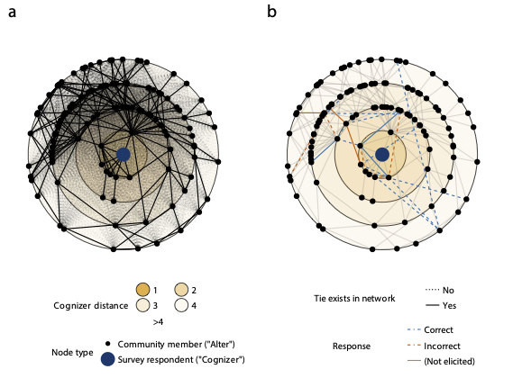

# SamplingPerceivedNetworks.jl

A Julia package for the distance-based sampling procedure used to collect cognitive social structures (CSS) data. It generates stratified lists of real and counterfactual relationships within a perceiver's social orbit: the network neighborhood out to a specified distance from the perceiver.


_Figure. Individuals judge the existence of relationships in their communities between pairs of individuals and then merged these data with sociocentric network data from 82 villages to assess their accuracy. a, The social network measured for a representative village for a survey respondent (blue dot), representing the social connections among other villages (black dots). Ties that exist between community members (solid lines) and the numerous ties that do not exist (dotted lines), with the shortest path between people and the survey respondent (the 'cognizer') indicated (shaded circles; 1–4 steps). b, Survey respondents judged the existence of social ties that did or did not exist for up to 40 pairs of individuals. Respondents answered correctly (blue) or not (red) (pairs not presented are in grey). Adapted from the Research Briefing for Feltham, Forastiere, & Christakis (2025)._

## Overview

The package generates survey questions about network perception in three stages:

1. Orbit generation: build a perceiver's social orbit out to distance d_max, including real and counterfactual edges.
2. Bin creation: group the possible relationships into sampling bins by distance and reality.
3. Stratified sampling: draw relationships from the bins according to a sampling specification.

This makes it feasible to collect data on network beliefs in large networks, as in the study of 10,072 adults in 82 villages in rural Honduras. The procedure was developed and applied in:

Feltham, E., Forastiere, L., & Christakis, N.A. (2025). "Cognitive representations of social networks in isolated villages." *Nature Human Behaviour*. [https://doi.org/10.1038/s41562-025-02221-6](https://doi.org/10.1038/s41562-025-02221-6)

## Installation

This package is not registered, install from GitHub (requires Julia 1.10 or later):

```julia
using Pkg
Pkg.add(url="https://github.com/human-nature-lab/SamplingPerceivedNetworks.jl")
```

## Quick Start

```julia
using SamplingPerceivedNetworks
using Graphs, MetaGraphs

# Create or load a network (a MetaGraph with a :name property on each vertex)
graph = # your MetaGraph

# Index vertices by name
set_indexing_prop!(graph, :name)

# Sampling specification: for each distance bin, (# real, # counterfactual)
desired = [(5, 5), (10, 10), (10, 10)]  # for d=1, d=2, d=3

# Sample for entire network
# (dₘₐₓ is the largest value in dvals)
sampling_lists = samplenetwork(graph; desired=desired, dvals=1:3)

# Convert to an edgelist DataFrame for export
using DataFrames, CSV
edgelist_df = psn_edgelists(sampling_lists)
CSV.write("sampling_lists.csv", edgelist_df)
```

Documentation: <https://human-nature-lab.github.io/SamplingPerceivedNetworks.jl> (build locally with `julia --project=docs docs/make.jl`).

See `example.jl` for a complete working example using a Watts-Strogatz small-world network.

## Key Functions

### Orbit Generation
- `vertexorbit(graph, vertex, dₘₐₓ)` - Generate social orbit extending to distance dₘₐₓ
- `vertexorbit_d(rad, d)` - Extract only ties at specific distance d

### Bin Creation
- `samplingbins(orbit, dₘₐₓ)` - Create sampling bins indexed by (distance, reality) tuples

### Stratified Sampling
- `samplebins([rng,] bins; desired, dvals, moreinfo)` - Sample relationships for one perceiver
- `samplenetwork([rng,] graph[, consents]; desired, dvals, moreinfo, shuffle)` - Generate lists for entire network. With `consents` (a `Dict` from name to a code of 0 to 3, required for every node), only perceivers who consented to the survey (1 or 2) get a list, and a pair is shown only if both members consented to photos (2 or 3)

### Design Presets and Inclusion Probabilities
- `deployed_design`, `merged_design` - `desired` and `dvals` presets, splatted in with `samplenetwork(graph; deployed_design...)`. `deployed_design` (4 separate degree bins of 5 real + 5 counterfactual) is the Honduras CSS design and the default; `merged_design` (degrees 1-2 combined at 10 + 10, then 5 + 5 at degrees 3 and 4) was never deployed
- `inclusionprobs(graph[, v][, consents]; desired, dvals)` - Exact probability `pi` that each pair is on a perceiver's list (`1/pi` is the estimation weight), computed from the graph with no random sampling, including the gap carry-over and consent filtering. Returns a DataFrame (`perceiver`, `from`, `to`, `bin`, `real`, `pi`; no `perceiver` column when `v` is given). It covers the stratified stage only, not the top-up of short lists or isolates

### Utilities
- `psn_edgelists(vertlists)` - Convert sampling output to DataFrame edgelist (columns `perceiver`, `from`, `to`, and with `moreinfo = true`, `bin` and `real`)
- `edgelist(graph)` - Extract sociocentric edgelist from graph
- `tupleize(alters1, alters2; sort = false)` - Create tuples from edgelist columns, alphanumerically sorted within each pair if `sort` is true

## Tests

```julia
using Pkg; Pkg.activate("."); Pkg.test()
```

The tests check that `inclusionprobs` agrees with empirical inclusion frequencies over many draws (with carry-over active and with consents). They also check the orbit and sampling bins against a brute-force computation from shortest-path distances on random graphs, the stratified draw (including how a short bin passes its shortfall to later bins), consent filtering, and the edgelist outputs.

## Dependencies

Built on [JuliaGraphs](https://juliagraphs.org):
- Graphs.jl: Core graph data structures and algorithms
- MetaGraphs.jl: Graphs with metadata on vertices/edges
- Random.jl: Random number generation for sampling
- StatsBase.jl: Statistical sampling functions
- DataFrames.jl: Edgelist output

## Features

- Distance-based stratified sampling of network ties
- Separate sampling of real and counterfactual relationships
- Consent filtering for photo permissions
- Reproducible sampling through per-perceiver RNG seeds
- Edgelist export
- Bins of single distances or ranges of distances

## Citation

If you use this package in your research, please cite:

```bibtex
@article{feltham_cognitive_2025,
  title = {Cognitive Representations of Social Networks in Isolated Villages},
  author = {Feltham, Eric and Forastiere, Laura and Christakis, Nicholas A.},
  year = {2025},
  month = jun,
  journal = {Nature Human Behaviour},
  issn = {2397-3374},
  doi = {10.1038/s41562-025-02221-6},
  keywords = {Biological anthropology,Human behaviour,Social anthropology,Social behaviour,Sociology}
}
```
